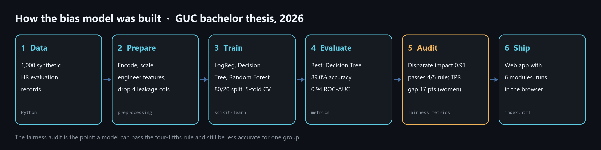
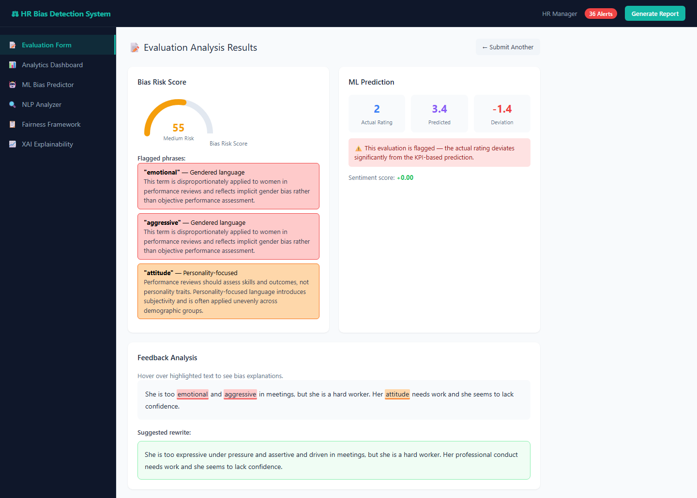
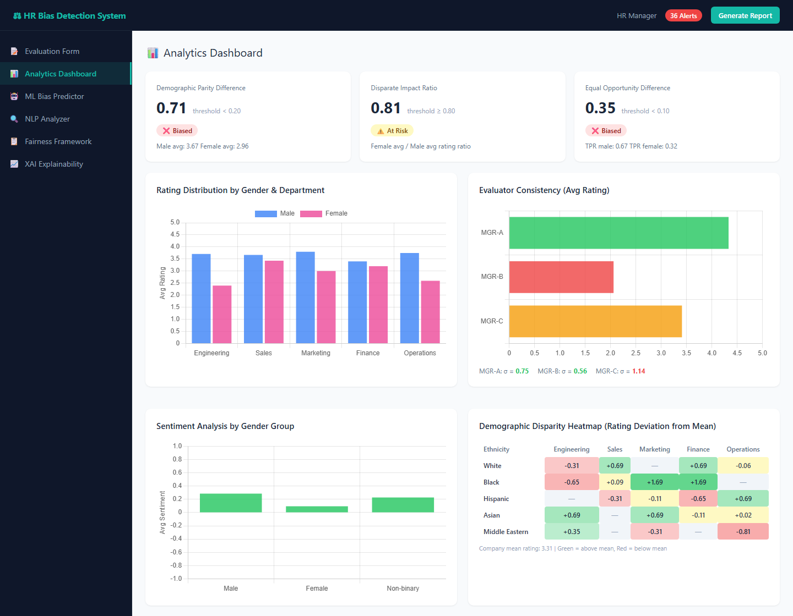
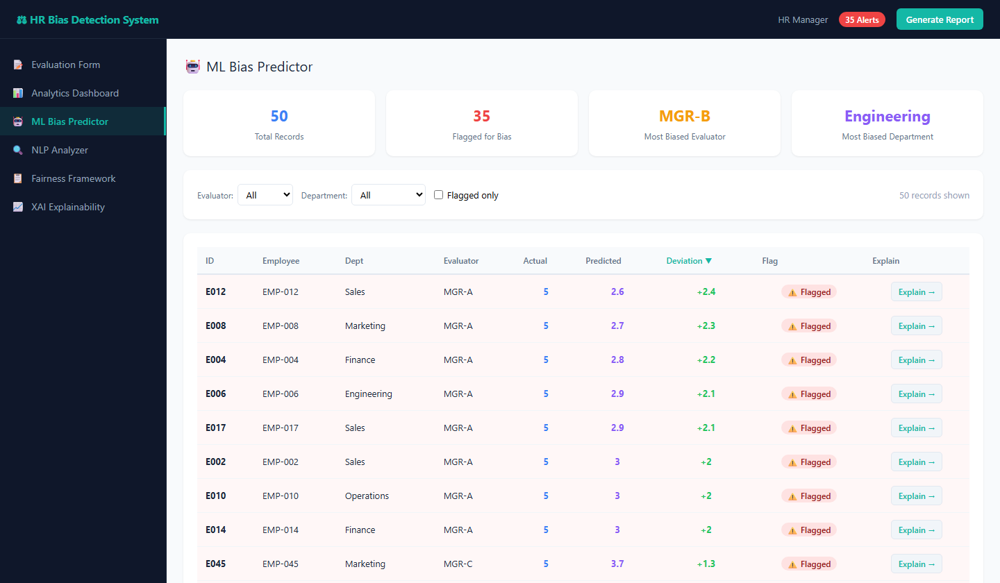
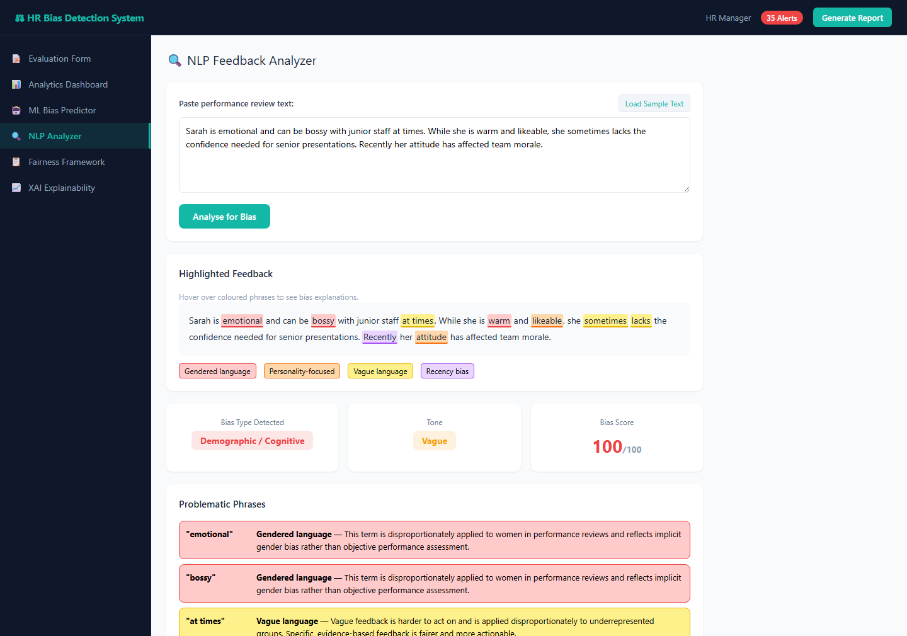
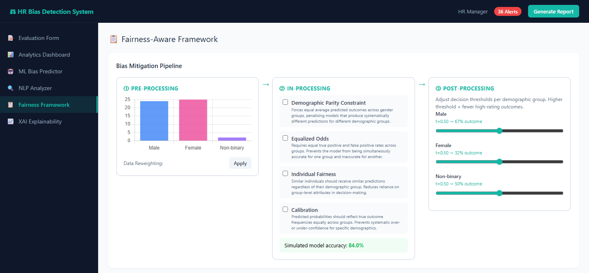
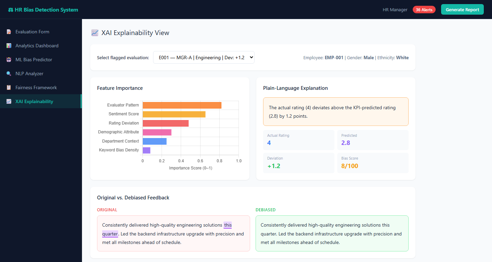

# HR Bias Detection System

Web app built for my bachelor thesis at the German University in Cairo (2026):
*Detecting Bias in Performance Evaluations: AI Approaches for Fairness in HR Feedback Systems*.

**Live demo:** https://mooo-9.github.io/hr-bias-detection/

It helps HR teams and managers spot bias in performance evaluations, both in the written feedback and in the ratings, while keeping a human in the loop. A rating that is far from what the employee's KPIs predict gets flagged, biased wording in the feedback is highlighted with a neutral rewrite, and fairness metrics show whether one group is rated differently from another.

## How the model was built

1. **Data.** 1,000 synthetic HR evaluation records.
2. **Prepare.** Categorical fields were encoded, numeric ones scaled, and new features engineered. Four columns that leaked the answer into the inputs were removed, so the model could not cheat.
3. **Train.** Logistic Regression, a Decision Tree and a Random Forest were trained in Python with scikit-learn, on a stratified 80/20 split with 5-fold cross-validation.
4. **Evaluate.** The Decision Tree was the best balance: 89.0% accuracy and 0.94 ROC-AUC (full table below).
5. **Audit for fairness.** The Decision Tree was checked for disparate impact and equal opportunity between men and women. See the results below.
6. **Ship.** The methods were turned into the six-module web app below, so an HR team can use them without writing code.

## Thesis results

| Model | Accuracy | Precision | Recall | F1 | ROC-AUC |
|---|---|---|---|---|---|
| Logistic Regression | 74.0% | 71.7% | 55.1% | 62.3% | 78.5% |
| **Decision Tree** | **89.0%** | **90.0%** | **80.8%** | **85.1%** | **94.2%** |
| Random Forest | 83.0% | 100.0% | 56.4% | 72.1% | 98.6% |

**Fairness audit (Decision Tree):** a disparate impact of 0.91 passes the four-fifths rule. However, the true positive rate for women was 17 points lower than for men (73.5% vs 90.5%), so fairness-constrained training is the next step. This is the main lesson of the thesis: a model can pass the common fairness test and still be less accurate for one group.

## A walk through the app

The demo runs entirely in the browser with 50 seeded sample evaluations, and you can download a bias report. The screenshots below are from the live demo.

### 1. Evaluation Form

A manager submits an evaluation and gets an instant bias gauge, the flagged phrases with an explanation for each, and a suggested neutral rewrite. The rating is compared with the rating predicted from the KPI, tenure and peer scores; here a rating of 2 against a predicted 3.4 is flagged.

### 2. Analytics Dashboard

Fairness cards (demographic parity, disparate impact, equal opportunity) with their thresholds, ratings by gender and department, evaluator consistency, sentiment by gender, and a heatmap of rating deviation by ethnicity and department.

### 3. ML Bias Predictor

Loads a dataset of evaluations and compares each actual rating with the rating expected from objective signals. Large deviations are flagged, and each flagged row links to its explanation. In the browser demo, the expected rating comes from a weighted formula of the KPI, tenure and peer scores, which is shown on the form; the scikit-learn models above were trained offline for the thesis.

### 4. NLP Analyzer

Rule-based detection of four kinds of biased language: gendered, personality-focused, vague and recency-biased. Each phrase is highlighted and explained.

### 5. Fairness Framework

A bias mitigation pipeline in three stages: pre-processing (reweighting the data), in-processing (constraints such as demographic parity and equalized odds) and post-processing (per-group decision thresholds), plus an audit log of flagged evaluations.

### 6. XAI Explainability

For any flagged evaluation, shows which factors drove the flag, a plain-language explanation, and the original feedback next to a debiased version.

## Files

- `index.html`: the app (React 18, Tailwind CSS, Chart.js; no build step)
- `bias_detection_hr.bpmn`: BPMN process model (open in Camunda Modeler or bpmn.io)
- `UseCase_BiasDetection_HR.drawio`: UML use case diagram (open in diagrams.net)
- `images/`: the screenshots and diagram in this README

## Run locally

Open `index.html` in a browser.
